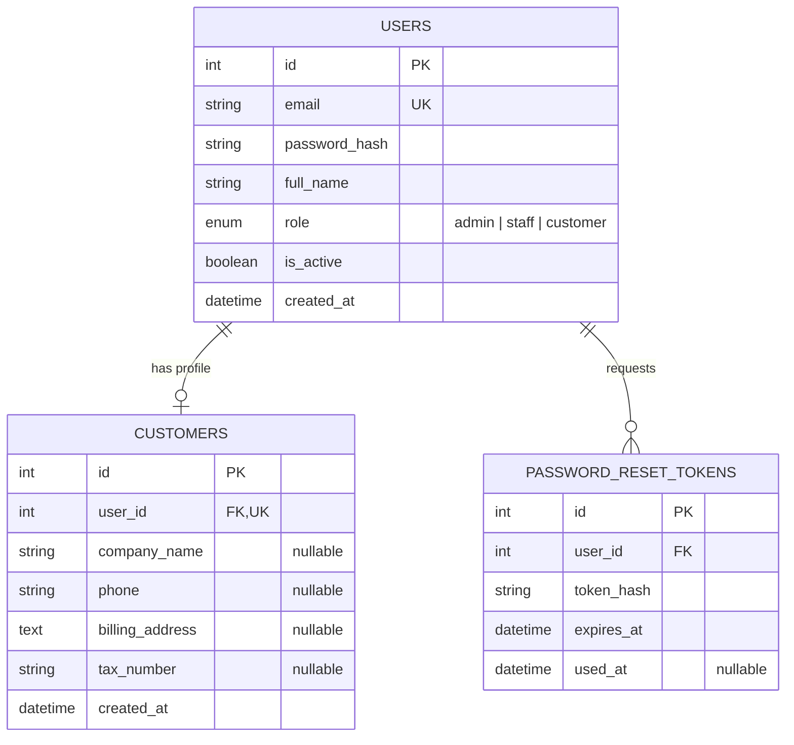
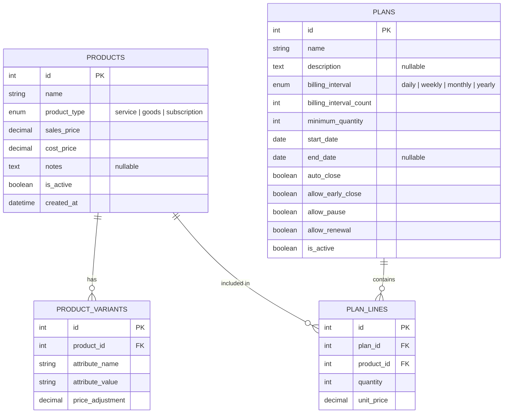
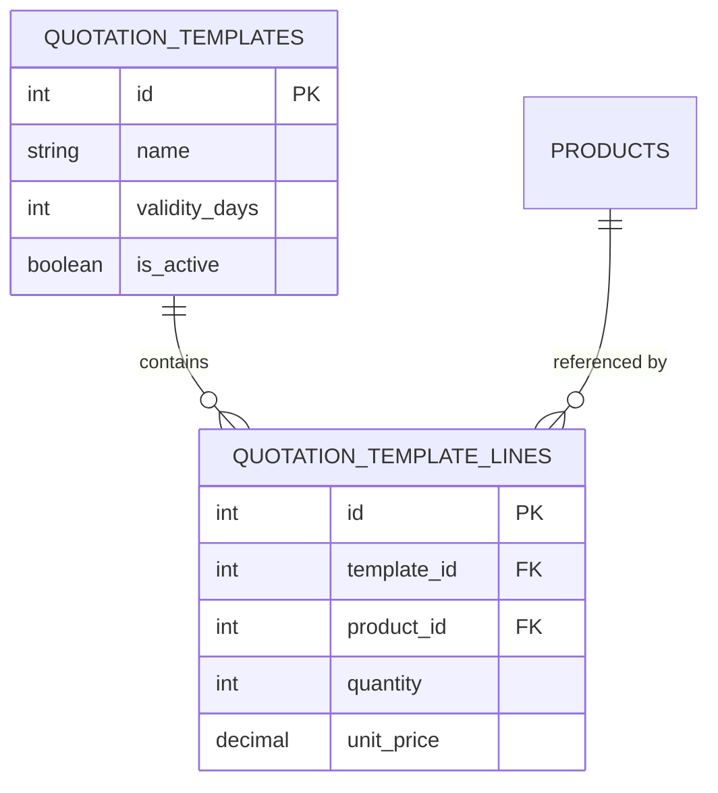
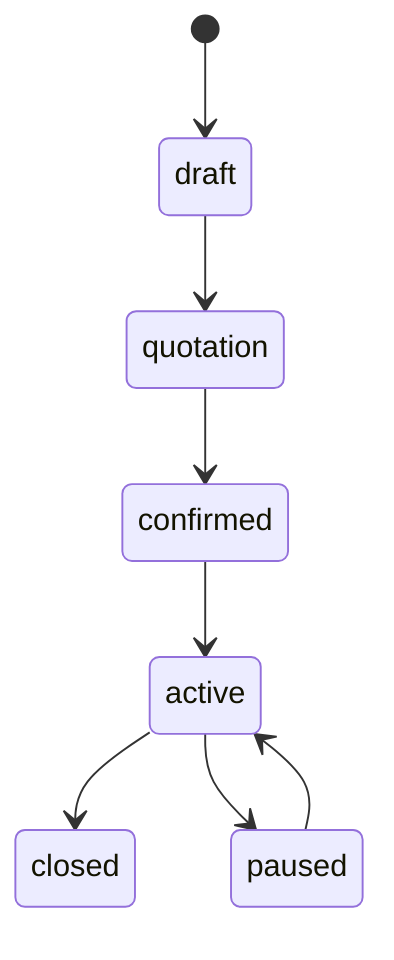
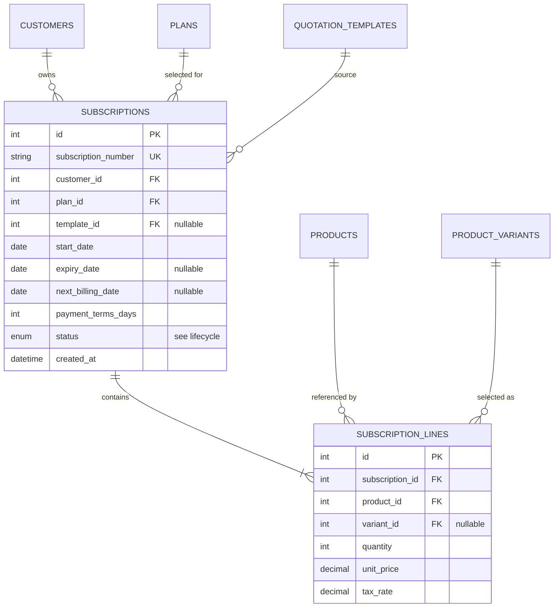
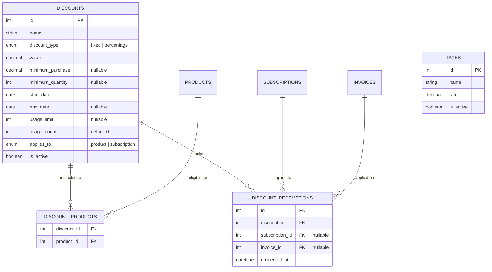
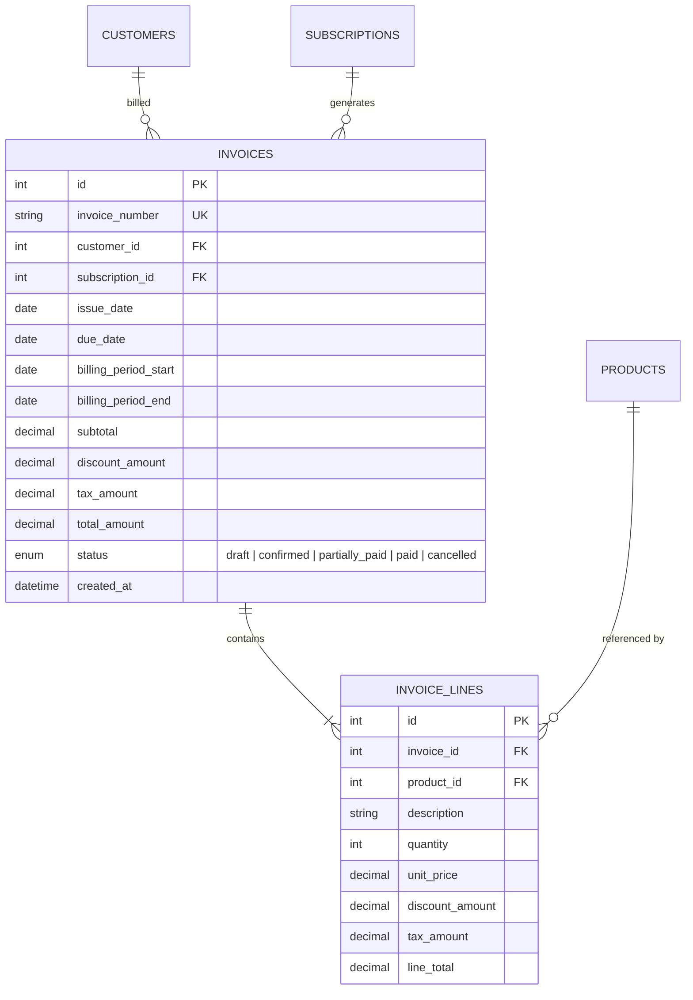
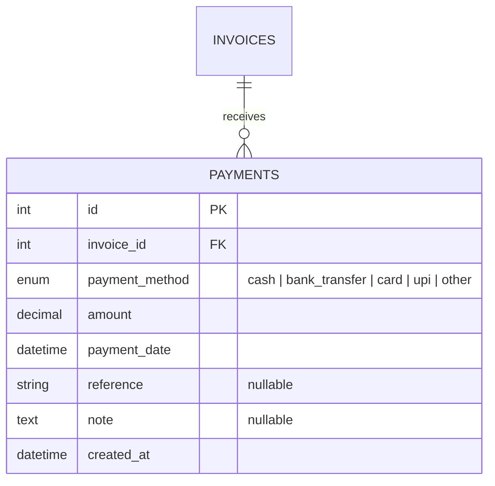
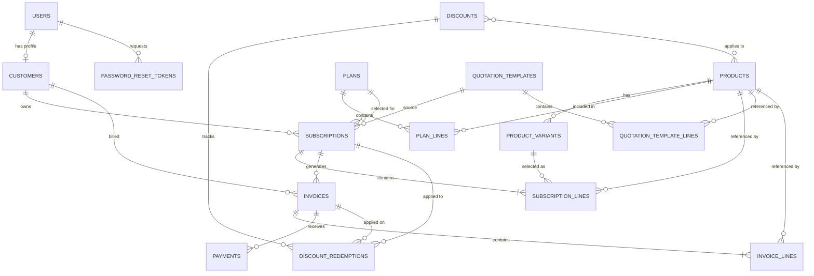

# Product Requirement Document

## Front-end

- Login and customer registration.
- Role-based dashboards: Admin, Staff, Customer.
- Product and plan management.
- Customer and subscription management.
- Quotations, invoices and payment screens.
- Customer portal to view their own subscriptions and invoices.
- Dashboard showing subscriptions, revenue, payments and overdue invoices.

## Back-end

- Authentication
- Products & Plans
- Quotations
- Discounts & Taxes
- Analytics
- Customers
- Subscriptions
- Invoicing
- Payments

## 1. Authentication

### Table: `users`

Stores login accounts for admins, staff and customers.

| Column | Type | Constraints |
| --- | --- | --- |
| `id` | Integer | Primary Key |
| `email` | String | UNIQUE, NOT NULL |
| `password_hash` | String | NOT NULL |
| `full_name` | String | NOT NULL |
| `role` | Enum | `admin` / `staff` / `customer` |
| `is_active` | Boolean | Default `true` |
| `created_at` | DateTime | NOT NULL |

### Table: `customers`

Stores billable customer profiles. Each customer account has one corresponding user.

| Column | Type | Constraints |
| --- | --- | --- |
| `id` | Integer | Primary Key |
| `user_id` | Integer | FK → `users.id`, UNIQUE |
| `company_name` | String | Optional |
| `phone` | String | Optional |
| `billing_address` | Text | Optional |
| `tax_number` | String | Optional |
| `created_at` | DateTime | NOT NULL |

### Table: `password_reset_tokens`

| Column | Type | Constraints |
| --- | --- | --- |
| `id` | Integer | Primary Key |
| `user_id` | Integer | FK → `users.id` |
| `token_hash` | String | — |
| `expires_at` | DateTime | — |
| `used_at` | DateTime | Nullable |

**Rules:** Email must be unique. Password must be more than 8 characters and contain uppercase, lowercase and special characters. Only Admin can create Staff accounts.

## 2. Products & Plans

### Table: `products`

| Column | Type | Constraints |
| --- | --- | --- |
| `id` | Integer | Primary Key |
| `name` | String | NOT NULL |
| `product_type` | Enum | `service` / `goods` / `subscription` |
| `sales_price` | Decimal | NOT NULL |
| `cost_price` | Decimal | NOT NULL |
| `notes` | Text | Optional |
| `is_active` | Boolean | Default `true` |
| `created_at` | DateTime | NOT NULL |

### Table: `product_variants`

| Column | Type | Constraints |
| --- | --- | --- |
| `id` | Integer | Primary Key |
| `product_id` | Integer | FK → `products.id` |
| `attribute_name` | String | NOT NULL |
| `attribute_value` | String | NOT NULL |
| `price_adjustment` | Decimal | Default `0` |

Example: Odoo brand variant adds 560 to the product's sales price.

### Table: `plans`

| Column | Type | Constraints |
| --- | --- | --- |
| `id` | Integer | Primary Key |
| `name` | String | NOT NULL |
| `description` | Text | Optional |
| `billing_interval` | Enum | `daily` / `weekly` / `monthly` / `yearly` |
| `billing_interval_count` | Integer | Default `1` |
| `minimum_quantity` | Integer | Default `1` |
| `start_date` | Date | NOT NULL |
| `end_date` | Date | Optional |
| `auto_close` | Boolean | Default `false` |
| `allow_early_close` | Boolean | Default `false` |
| `allow_pause` | Boolean | Default `false` |
| `allow_renewal` | Boolean | Default `false` |
| `is_active` | Boolean | Default `true` |

### Table: `plan_lines`

Join table between `plans` and `products` (many-to-many).

| Column | Type | Constraints |
| --- | --- | --- |
| `id` | Integer | Primary Key |
| `plan_id` | Integer | FK → `plans.id` |
| `product_id` | Integer | FK → `products.id` |
| `quantity` | Integer | NOT NULL |
| `unit_price` | Decimal | NOT NULL |

## 3. Quotations

### Table: `quotation_templates`

| Column | Type | Constraints |
| --- | --- | --- |
| `id` | Integer | Primary Key |
| `name` | String | — |
| `validity_days` | Integer | — |
| `is_active` | Boolean | — |

### Table: `quotation_template_lines`

| Column | Type | Constraints |
| --- | --- | --- |
| `id` | Integer | Primary Key |
| `template_id` | Integer | FK → `quotation_templates.id` |
| `product_id` | Integer | FK → `products.id` |
| `quantity` | Integer | — |
| `unit_price` | Decimal | — |

A quotation template provides reusable product lines and a validity period. For the MVP, a quotation can be represented by a subscription in `quotation` status.

## 4. Subscriptions

### Table: `subscriptions`

| Column | Type | Constraints |
| --- | --- | --- |
| `id` | Integer | Primary Key |
| `subscription_number` | String | UNIQUE |
| `customer_id` | Integer | FK → `customers.id` |
| `plan_id` | Integer | FK → `plans.id` |
| `template_id` | Integer | FK → `quotation_templates.id`, Nullable |
| `start_date` | Date | NOT NULL |
| `expiry_date` | Date | Nullable |
| `next_billing_date` | Date | Nullable |
| `payment_terms_days` | Integer | Default `0` |
| `status` | Enum | See lifecycle |
| `created_at` | DateTime | NOT NULL |

### Table: `subscription_lines`

| Column | Type | Constraints |
| --- | --- | --- |
| `id` | Integer | Primary Key |
| `subscription_id` | Integer | FK → `subscriptions.id` |
| `product_id` | Integer | FK → `products.id` |
| `variant_id` | Integer | FK → `product_variants.id`, Nullable |
| `quantity` | Integer | — |
| `unit_price` | Decimal | — |
| `tax_rate` | Decimal | — |

**Status lifecycle:**

A subscription connects a plan to a specific customer. Store agreed prices in subscription lines so later product price changes do not alter existing subscriptions.

## 5. Discounts & Taxes

### Table: `taxes`

| Column | Type | Constraints |
| --- | --- | --- |
| `id` | Integer | Primary Key |
| `name` | String | — |
| `rate` | Decimal | — |
| `is_active` | Boolean | — |

### Table: `discounts`

| Column | Type | Constraints |
| --- | --- | --- |
| `id` | Integer | Primary Key |
| `name` | String | — |
| `discount_type` | Enum | `fixed` / `percentage` |
| `value` | Decimal | — |
| `minimum_purchase` | Decimal | Nullable |
| `minimum_quantity` | Integer | Nullable |
| `start_date` | Date | — |
| `end_date` | Date | Nullable |
| `usage_limit` | Integer | Nullable |
| `usage_count` | Integer | Default `0` |
| `applies_to` | Enum | `product` / `subscription` |
| `is_active` | Boolean | — |

### Table: `discount_products`

| Column | Type | Constraints |
| --- | --- | --- |
| `discount_id` | Integer | FK → `discounts.id` |
| `product_id` | Integer | FK → `products.id` |

### Table: `discount_redemptions`

| Column | Type | Constraints |
| --- | --- | --- |
| `id` | Integer | Primary Key |
| `discount_id` | Integer | FK → `discounts.id` |
| `subscription_id` | Integer | FK → `subscriptions.id`, Nullable |
| `invoice_id` | Integer | FK → `invoices.id`, Nullable |
| `redeemed_at` | DateTime | — |

Only Admin can create and manage discount and tax rules.

## 6. Invoicing

### Table: `invoices`

| Column | Type | Constraints |
| --- | --- | --- |
| `id` | Integer | Primary Key |
| `invoice_number` | String | UNIQUE |
| `customer_id` | Integer | FK → `customers.id` |
| `subscription_id` | Integer | FK → `subscriptions.id` |
| `issue_date` | Date | — |
| `due_date` | Date | — |
| `billing_period_start` | Date | — |
| `billing_period_end` | Date | — |
| `subtotal` | Decimal | — |
| `discount_amount` | Decimal | — |
| `tax_amount` | Decimal | — |
| `total_amount` | Decimal | — |
| `status` | Enum | `draft` / `confirmed` / `partially_paid` / `paid` / `cancelled` |
| `created_at` | DateTime | — |

### Table: `invoice_lines`

| Column | Type | Constraints |
| --- | --- | --- |
| `id` | Integer | Primary Key |
| `invoice_id` | Integer | FK → `invoices.id` |
| `product_id` | Integer | FK → `products.id` |
| `description` | String | — |
| `quantity` | Integer | — |
| `unit_price` | Decimal | — |
| `discount_amount` | Decimal | — |
| `tax_amount` | Decimal | — |
| `line_total` | Decimal | — |

Invoices are generated from subscription lines. Invoice line values are snapshots and must not change when product prices or tax rules change.

## 7. Payments

### Table: `payments`

| Column | Type | Constraints |
| --- | --- | --- |
| `id` | Integer | Primary Key |
| `invoice_id` | Integer | FK → `invoices.id` |
| `payment_method` | Enum | `cash` / `bank_transfer` / `card` / `upi` / `other` |
| `amount` | Decimal | — |
| `payment_date` | DateTime | — |
| `reference` | String | Nullable |
| `note` | Text | Nullable |
| `created_at` | DateTime | — |

An invoice can have multiple payments. Its status is `partially_paid` when some amount is paid and `paid` when the full amount is received.

## 8. Analytics

Dashboard should provide:

- Active subscriptions
- Total invoiced amount
- Total payments collected
- Outstanding amount
- Overdue invoices

## 9. API Endpoints

All routes are prefixed with `/api/v1`.

| Module | Method | Endpoint |
| --- | --- | --- |
| Auth | POST | `/auth/register` |
| Auth | POST | `/auth/login` |
| Auth | POST | `/auth/refresh` |
| Auth | POST | `/auth/logout` |
| Customers | GET, POST | `/customers` |
| Customers | GET, PATCH | `/customers/{id}` |
| Products | GET, POST | `/products` |
| Products | GET, PATCH | `/products/{id}` |
| Variants | GET, POST | `/products/{id}/variants` |
| Plans | GET, POST | `/plans` |
| Plans | GET, PATCH | `/plans/{id}` |
| Quotations | GET, POST | `/quotation-templates` |
| Subscriptions | GET, POST | `/subscriptions` |
| Subscriptions | GET, PATCH | `/subscriptions/{id}` |
| Subscriptions | POST | `/subscriptions/{id}/confirm` |
| Subscriptions | POST | `/subscriptions/{id}/activate` |
| Subscriptions | POST | `/subscriptions/{id}/pause` |
| Subscriptions | POST | `/subscriptions/{id}/close` |
| Invoices | GET, POST | `/invoices` |
| Billing | POST | `/billing/generate` |
| Payments | GET, POST | `/payments` |
| Taxes | GET, POST | `/taxes` |
| Discounts | GET, POST | `/discounts` |
| Dashboard | GET | `/dashboard/summary` |

## 10. Entity Relationship Diagram

Overview of all relationships. Table-level detail lives in the per-module diagrams above.

## 11. Core Business Rules

1. Email must be unique; passwords must meet the stated complexity requirements.
2. Only Admin can create staff, products, plans, taxes, and discounts.
3. Customers can access only their own subscriptions, invoices, and payments.
4. Subscription status changes must follow the defined lifecycle.
5. Subscription quantities must satisfy the plan's minimum quantity.
6. Discounts must satisfy their date, quantity, purchase, and usage-limit conditions.
7. Invoice generation must not create duplicate invoices for the same subscription and billing period.
8. Use `Decimal` for monetary values.
9. Preserve historical prices and tax values in subscription and invoice lines.
10. Use database transactions for invoice generation and payment recording.

**Definition of Done:** A customer can register, receive a subscription, be invoiced automatically, have a payment recorded, and see the updated invoice status. Admin/staff can manage the workflow and view the dashboard.
